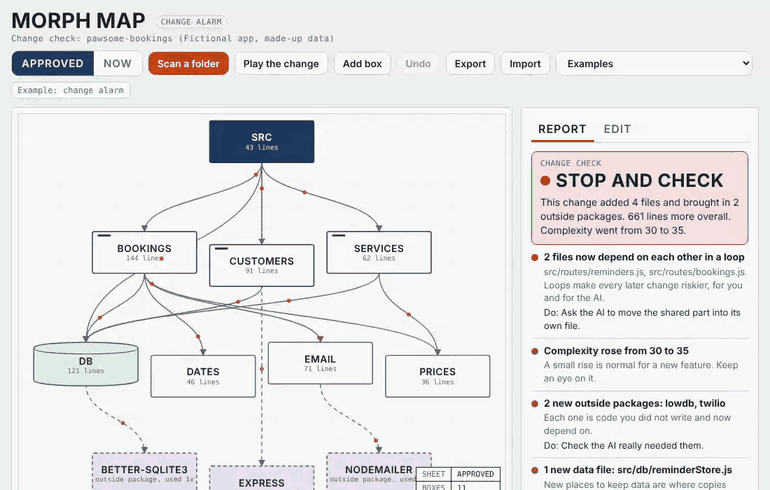

# Morph Map

**See what your AI coder just did to your app. Approve it or send it back, without reading code.**

Morph Map scans your project and draws it as a map. You approve the map. After every change your AI coder makes, scan again: Morph Map plays the difference, says what changed in plain words, and gives a verdict. One HTML file, no install, no account, and nothing leaves your browser.



**[Open Morph Map](https://dannynatha-max.github.io/morph-map/)**. It opens on a made-up example of an AI change that needs checking.

## The change alarm

1. **Scan.** Press **Scan a folder** and pick your project folder (or drag it onto the map). This first scan becomes your approved map.
2. **Let the AI work.** Ask Claude Code, Cursor, Lovable or any AI coder for a change.
3. **Scan again.** Pick the same folder. Morph Map morphs Approved into Now and shows a verdict:

| Verdict | Means | Triggered by |
|---|---|---|
| **Looks safe** | No warning signs | Nothing below fired |
| **Worth a look** | Check before you accept | A new outside package, a new data file, a new starting point, a core file removed or changed by 30% or more, a file growing past 400 lines, a new file that connects to nothing, complexity up 4 to 9 points, or a very large change |
| **Stop and check** | Likely made the app harder to change | Complexity up 10 points or more, or files that now depend on each other in a loop |

4. **Approve or send it back.** Approve makes Now your new approved map. Or press **Copy a message for the AI** to get a ready-made note asking the AI to explain or fix each warning.

Every rule is a plain comparison of the two scans and is listed in the app under "How this is scored". If you drew a plan first, the check also reports how much of the plan is now in the code.

**From the command line** (for a git hook or a build step):
```
node scanner/morph-scan.js . --since HEAD~1 --out change.json
```
This compares your project with the previous commit, prints the verdict, and exits with code 1 on "Stop and check". Use `--check approved.json` to compare with a map you exported earlier. Import `change.json` to watch the change play.

## What else you can do

| | |
|---|---|
| **Plan** | Edit a second map called Planned. Add, delete, rename and connect boxes, and leave notes for the build. |
| **Play** | Animate Today into Planned. The complexity score counts down as the map changes. |
| **Report** | Scores and findings worked out from the scan, each one a plain rule you can check. |
| **Brief** | Turn the difference between the two maps into a step-by-step plan for Claude Code, Cursor or any AI coder. |
| **Learn** | For code: where to start reading, the core files, import loops, big files, and a quiz built from the scan. |
| **Blast radius** | Pick any box and see everything reachable from it by following the arrows. |
| **Audit a website** | Map a public site and get structure findings and a passive security grade. |

## Quick start

**1. Map a code project.** Open Morph Map, press **Scan a folder** and pick the project. Reads JavaScript, TypeScript, Python, Vue, Svelte and HTML. Big projects are grouped by folder so the map stays readable. Folder picking needs a desktop browser. The command line does the same job: `node scanner/morph-scan.js ./your-project --out my-map.json`, then **Import**.

**2. Map a website.** Open the site in your browser, open the console, paste `scanner/morph-web.js` and press Enter. It reads up to 40 public pages and copies a map you can Import.

**3. Plan and play.** Switch to **Planned**, change the map, then press **Play the change**. Open the **Report** tab and press **Write the AI coder brief** when you are happy.

## How the score works

Complexity runs from 0 to 100 and uses the same formula for Today and Planned, so you can compare them fairly.

| Part | Up to | Measured from |
|---|---|---|
| Size | 30 | Number of boxes (full marks at 40) |
| Tangle | 35 | Arrows per box (full marks at 3) |
| Depth | 20 | Most steps from the top box (full marks at 6) |
| Copies | 15 | Dashed arrows touching a data store, meaning the same data kept in two places (full marks at 3) |

Under 35 is Light, under 65 is Medium, and 65 and up is Heavy.

## What the report checks

**Code (Learn mode):** where the program starts, the files most others depend on, import loops, files over 400 lines, files that connect to nothing, and outside packages.

**Websites (Audit mode):**
- **Structure:** a menu repeated on every page, look-alike pages that could be one page with filters, a checkout no link reaches, pages more than 3 clicks deep, broken links, and outside services.
- **Security (passive):** HTTPS, HSTS, Content Security Policy, frame protection, content-type and referrer settings, and session-like cookies that scripts can read.

Security checks use only what any visitor's browser already receives. Morph Map never logs in, sends forms or probes a site.

**Plan check:** tick which findings your plan fixes. The report shows how many issues the plan covers, and the brief tells your AI coder exactly what to fix.

## Tested on real projects

| Project | Type | What it showed |
|---|---|---|
| Express 2014 and today | Code | 13 files down to 7 as the router moved out, complexity 45 to 36 |
| python.org, gov.uk, daraz.pk | Websites | Big repeated menus on two of them, no Content Security Policy on two, HTTPS enforced for 1 to 2 years on two |

Each real site exposed a rule that was too eager. Those rules were fixed before this release. If you find a false alarm, please open an issue with the site and the finding.

## Use it responsibly

- Scan only code you are allowed to read, and only the public pages of websites.
- The website scanner reads robots.txt first and skips anything a site asks crawlers to avoid. It waits between pages and stops at 40.
- Share security findings privately with the site owner, never in public.
- A map is a reading aid. It is not a copy of anyone's product.

## What's in the box

| File | What it does |
|---|---|
| `index.html` | The app: scan, change alarm, map editor, player, report, brief, quiz and blast radius |
| `report.js` | The scoring, finding and change-alarm rules, readable on their own |
| `scanner/scan-core.js` | Turns a list of code files into a map. Shared by the app and the command line |
| `scanner/morph-scan.js` | Command line: map a folder, or check a change with `--since` or `--check` |
| `scanner/morph-web.js` | Reads a public website into a map |
| `examples/` | Ready-made maps: a change alarm, a fictional shop audit, Express 2014 vs today |
| `demo-scans.html` | Seven scanned projects to explore |
| `tools/inline.js` | Copies `report.js` and `scan-core.js` into `index.html` after you edit them |
| `test/run.js` | Checks for the scanner and the change rules: `node test/run.js` |

## Coming next

- A ready-made hook so the check runs by itself after every AI change
- A GitHub Action that posts the verdict on every pull request
- More languages in the scanner
- Clearer maps for sites with very large menus

## Licence and credit

Morph Map is free for individuals, learners, open-source projects and non-commercial use. Companies and other commercial users need a paid licence. See `LICENSE` for the full terms.

Using Morph Map in a video, course, article or research? Please credit it. GitHub's **Cite this repository** button gives you the citation.

Built by Danny Natha.
