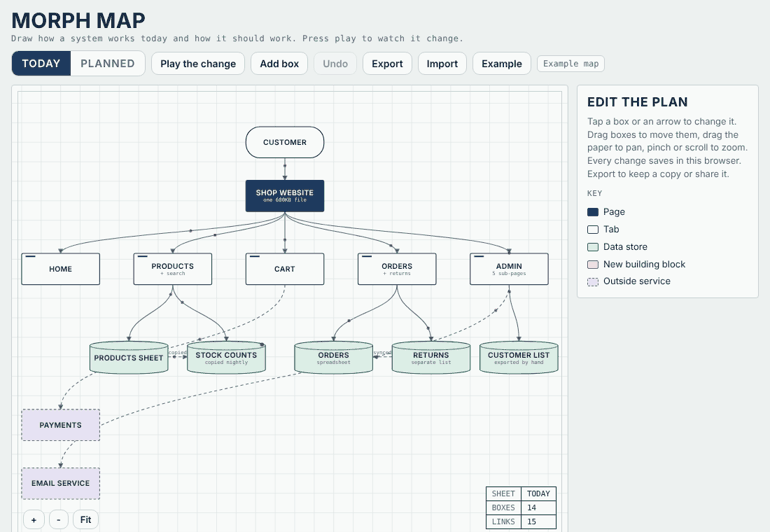

# Morph Map 2: reverse mode

Everything in Morph Map 1, plus **scanners that read an existing project and draw it for you**: a code repository, an app, or a public website. Made for learning how real projects are put together and how they change over time.



**[Try the scanned examples](https://dannynatha-max.github.io/morph-map/demo-scans.html)**: seven real projects, from a 15-file tool to a 386-file React app, plus Express from 2014 to today and two websites.

## 1. Map a code repository or app
```
node scanner/morph-scan.js ./any-project --out my-map.json
```
Then press **Import** and pick `my-map.json`. Reads JavaScript, TypeScript, Python, Vue, Svelte and HTML. Files or folders become boxes, imports become arrows, outside packages sit along the bottom. No install needed beyond Node 18+.

## 2. Map a public website
Open the site, open the browser console, paste `scanner/morph-web.js` and press Enter. It reads up to 40 public pages, slowly, and copies a map you can Import. It finds sections, forms, outside services (analytics, widgets, CRMs, video) and how sections link.

## 3. Watch a project change
Scan an old version and a new one (an old git tag, or an old copy from the Wayback Machine). Put the old map in `today` and the new one in `planned`, then press **Play**. `examples/express-2014-to-now.json` does this for Express.

## Use it responsibly
- **For learning.** Only scan code you are allowed to read and websites' public pages.
- **Be gentle.** The website scanner reads the site's robots.txt first and skips any page the site asks crawlers to avoid. It waits between pages and stops at 40. Respect a site's terms too.
- **It only sees the outside of a website.** Server code, databases and anything behind a login stay private.
- A map is a reading aid, not a copy of anyone's product.

## How to use
- **Drag** boxes to move them, drag the paper to pan, scroll or pinch to zoom
- **Tap a box** to rename it, change its kind or leave a note
- **Add box** and **Delete box** to change the plan
- **Draw arrow from here**, then tap the box it should point to
- **Today / Planned** switches maps; **Play the change** animates between them
- **Export / Import** saves your map as a JSON file to keep or share
- Everything saves in your own browser. Nothing is sent anywhere.

## What's in the box
| File | What it does |
|---|---|
| `index.html` | The map editor and player |
| `demo-scans.html` | Seven scanned examples to explore |
| `scanner/morph-scan.js` | Reads a code folder into a map |
| `scanner/morph-web.js` | Reads a public website into a map |
| `examples/` | Ready-made maps, including a before and after |

## Licence and credit
MIT. You can use, change and share this freely, as long as you keep the copyright notice in `LICENSE`.
Using it in research or writing? GitHub's **Cite this repository** button (from `CITATION.cff`) gives you the citation.
